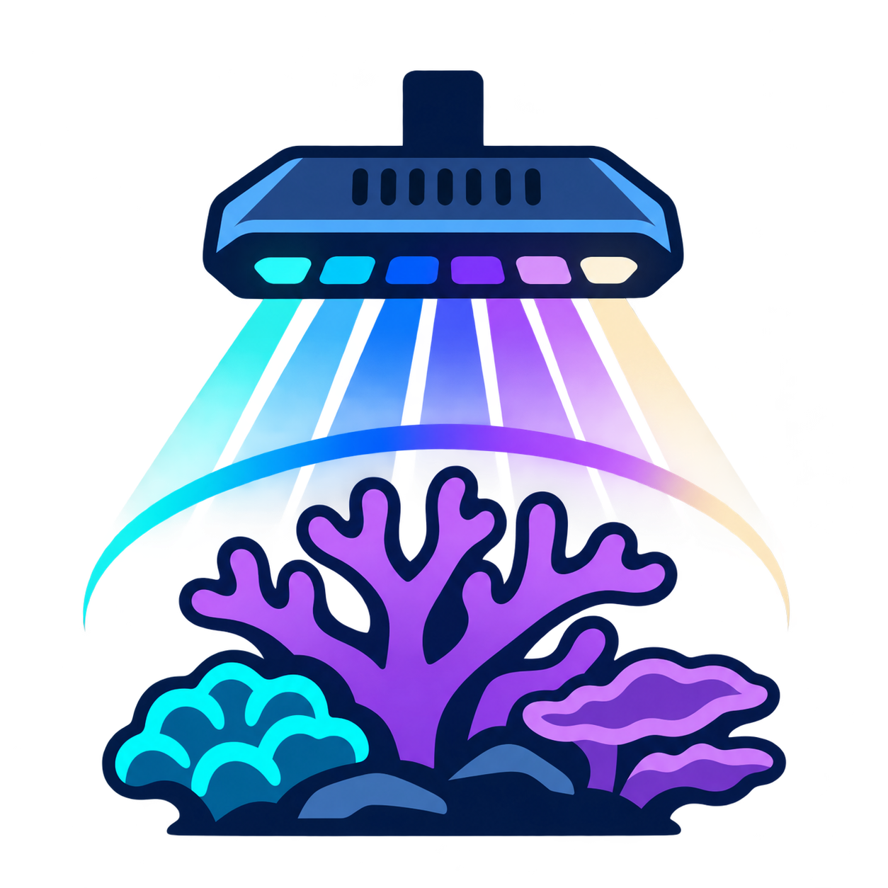
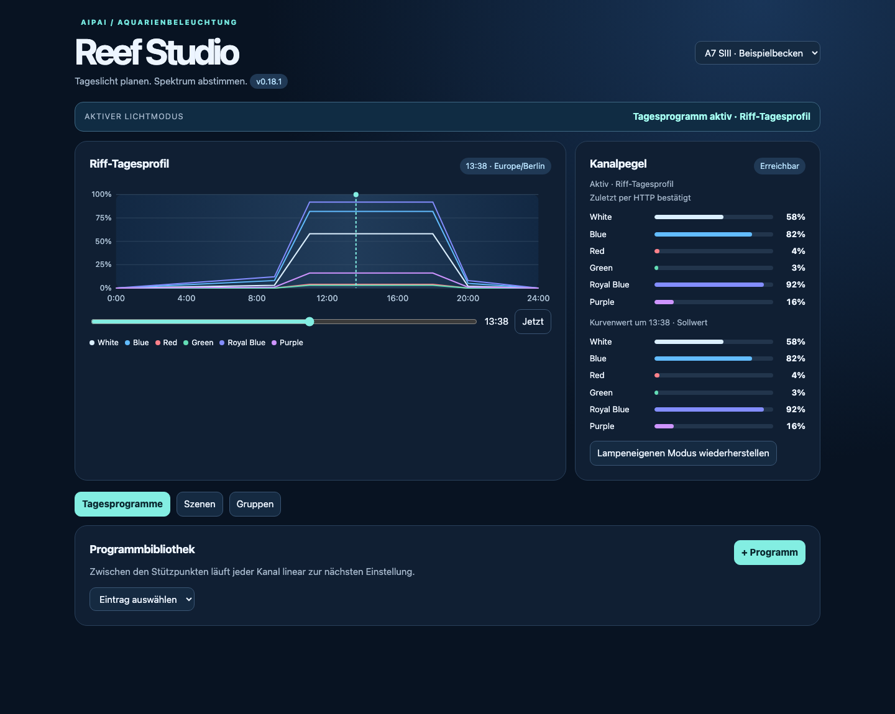
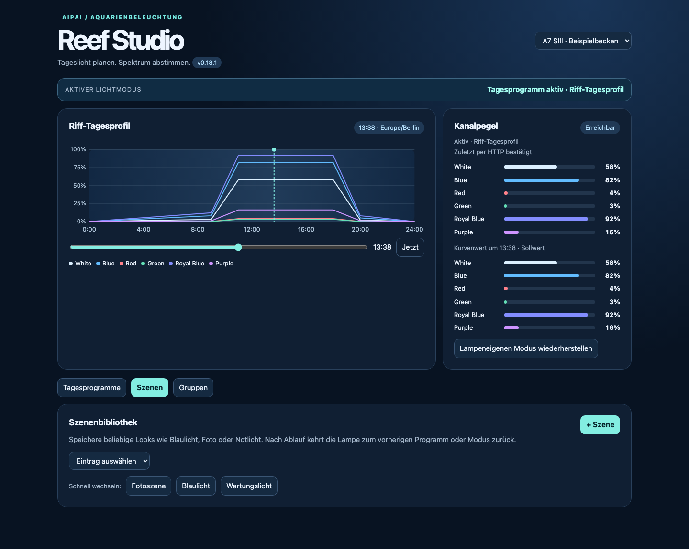

<p align="center"></p>

# AIPAI Reef Studio

Lokale Home-Assistant-Integration für AIPAI Aquarium-LEDs, einschließlich A7,
A8SE, A8SE II MAX und verwandter Doseen-Controller. Reef Studio steuert die
Lampen direkt im lokalen Netzwerk über ihre HTTP-Schnittstelle.

> Dieses Projekt ist ein unabhängiges, MIT-lizenziertes Derivat von
> [`markosharknz1/ha-aipai-light`](https://github.com/markosharknz1/ha-aipai-light).
> Es ist weder mit AIPAI noch mit Doseen verbunden.

## Funktionen

**Neu: [AIPAI Reef Bridge für ESP32](reef-bridge/README.md)** – experimentelle Standalone-Firmware mit eigener Weboberfläche, USB-/Browser-Installer für macOS und Windows sowie optionaler Home-Assistant-Anbindung mit lokalem Fallback.

- Reef Studio als native Home-Assistant-Seitenleiste
- Mehrere Tagesprogramme mit beliebig vielen Stützpunkten
- Lineare oder weiche Sinusrampen für Sonnenauf- und -untergang
- Szenen für Blaulicht, Fotos, Wartung oder Notbetrieb mit zeitgesteuerter Rückkehr zum Tagesprogramm
- Mehrere Lampen in synchronisierten Gruppen
- Lokale Steuerung ohne Cloud, MQTT-Broker oder ESP-Flash
- Pro Lampe auswählbares sechs- oder achtkanaliges Profil
- Eigene IANA-Zeitzone je Lampe mit Sommerzeitkorrektur
- Live-Anzeige der Tageskurve, Sollwerte und gemeldeten Kanalpegel

## Einblick in Reef Studio

| Tagesprogramm und Live-Pegel | Szenenbibliothek und Schnellwechsel |
| --- | --- |
|  |  |

*Die Screenshots zeigen Beispieldaten; Lampenname, Kanalwerte und Programme stammen nicht aus einem echten Aquarium.*

## Unterstützte Kanalprofile

| Profil | Kanäle |
| --- | --- |
| A7 SIII / A8SE v1 | White, Blue, Red, Green, Royal Blue, Purple |
| A8SE II MAX / MAX Pro | White, Blue, Red, Green, Royal Blue, Purple, UV, Warm White |

Die Firmwarekennung allein ist nicht immer zuverlässig. Die tatsächliche Kanalbelegung wird deshalb beim Einrichten in den Optionen gewählt.

## Installation über HACS

1. HACS öffnen und über das Drei-Punkte-Menü **Custom repositories** wählen.
2. Die URL dieses Repositories hinzufügen und als Typ **Integration** wählen.
3. **AIPAI Reef Studio** herunterladen und Home Assistant neu starten.
4. Unter **Einstellungen → Geräte & Dienste → Integration hinzufügen** nach **AIPAI Reef Studio** suchen.
5. **Search network** auswählen und die gefundene Lampe hinzufügen.
6. In den Integrationsoptionen **Local control**, das Kanalprofil und die gewünschte Zeitzone einstellen.

Danach erscheint **Reef Studio** für Administratoren in der Seitenleiste.

## Installation ohne HACS

Den Ordner `custom_components/aipai_light` nach `/config/custom_components/aipai_light` kopieren und Home Assistant neu starten.

## Reef Studio verwenden

### Tagesprogramme

Ein Programm besteht aus Zeitpunkten und den Prozentwerten aller Kanäle. Zwischen zwei Punkten kann der Übergang linear oder sinusförmig verlaufen. Der Rampen-Assistent erzeugt aus Sonnenaufgang, Hochrampe, Sonnenuntergang und Runterrampe direkt ein vollständiges Programm. Erst **Programm aktivieren** übernimmt es für die Lampe.

### Szenen

Szenen speichern ein festes Spektrum. Sie können für 1 bis 60 Minuten gestartet oder im manuellen Modus dauerhaft gehalten werden. Nach Ablauf beziehungsweise nach dem Beenden übernimmt wieder das aktive Tagesprogramm oder der vorherige Lampenmodus.

### Gruppen

Eine Gruppe enthält mindestens zwei Lampen. Gruppeneinträge starten Programme oder Szenen mit demselben Namen auf allen Mitgliedern. Dadurch können Lampen mit unterschiedlichen Kanalprofilen zusammen arbeiten, ohne nicht vorhandene Kanäle anzusprechen.

## Entwicklung und Releases

Die Integration wird mit Python 3.13+ und Node.js geprüft:

```bash
python3 tools/validate_release.py
python3 -m compileall -q custom_components/aipai_light
node --check custom_components/aipai_light/panel/reef-studio.js
```

Für eine Veröffentlichung:

1. `version` in `custom_components/aipai_light/manifest.json` erhöhen.
2. Einen gleichlautenden Eintrag in [CHANGELOG.md](CHANGELOG.md) ergänzen.
3. Nach dem Push auf `main` prüft der Release-Workflow die Version und erstellt automatisch den GitHub-Tag sowie die GitHub Release.

HACS erkennt die neue Release und bietet Anwendern ein Update an.

## Lokale Schnittstelle

Die Integration liest `GET /?read=config` und sendet temporäre Kanalwerte über `GET /?<kanal>=<wert>`. Persistente Geräteeinstellungen werden nur nach einer vorherigen Prüfung der Lampenidentität geschrieben. Die Hilfsprogramme im Ordner `tools/` unterstützen die Diagnose im lokalen Netz.

## Lizenz

MIT. Die ursprünglichen Copyright-Hinweise in [LICENSE](LICENSE) bleiben Teil des Derivats.

## Projektseite

Fehlerberichte und Funktionswünsche bitte über das
[GitHub-Repository](https://github.com/xsiimonox/aipai-reef-studio) einreichen.
