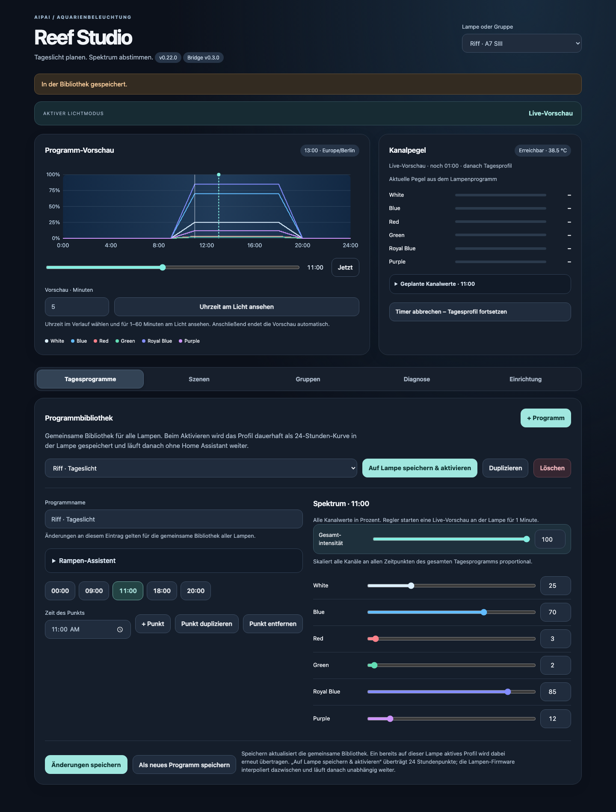
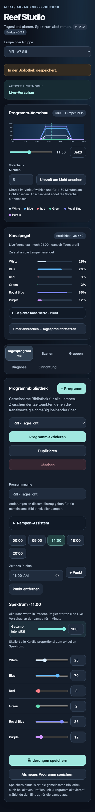
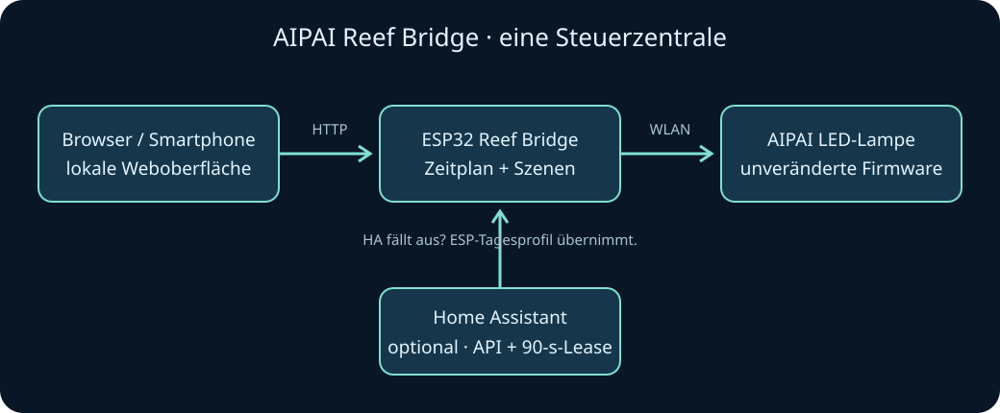

# AIPAI Reef Bridge für ESP32

Firmware **0.11.0** mit demselben AiPai-Studio-Editor wie Home Assistant. Tagesprogramme werden standardmäßig dauerhaft in den Lampen gespeichert; Home Assistant ist optional. Experimenteller Stand: Builds und simulierte Browsertests sind geprüft; die fabrikneue Lampenübernahme, OTA-Aktualisierung und der Betrieb mit mehreren echten Lampen benötigen noch einen Hardwaretest.



<details><summary>Mobile Ansicht und Architektur</summary>





</details>

## Gemeinsame Bedienung

- Identischer Editor und identisches Design mit der HA-Integration: grafischer Tagesverlauf, duplizierbare Stützpunkte mit Uhrzeit, lineare Übergänge, Rampen-Assistent und ein proportionaler Gesamtintensitätsregler für das vollständige Tagesprofil.
- Gemeinsame lokale Programm- und Szenenbibliothek für alle Lampen dieser Bridge. Neue Einträge, Bearbeiten, Duplizieren, Löschen und Aktivieren. Bis 32 Programme und 32 Szenen, insgesamt maximal 48 KB JSON bzw. die verfügbare Parser-Kapazität; größere Änderungen werden mit Fehlermeldung abgelehnt.
- Bis zu zwölf Lampen im selben Netz; jeweils Name, IP, Seriennummer, 6/8 Kanäle und POSIX-Zeitzone. Bis 16 Gruppen, auch mit nur einer Lampe. Eine gemischte Gruppe zeigt alle acht Kanäle; UV und Warm White wirken nur auf Achtkanal-Lampen. Sechskanal-Lampen ignorieren die zusätzlichen Werte. MAX-Profile bleiben beim Bearbeiten an Sechskanal-Lampen vollständig erhalten. Für häufige Gruppen-Vorschauen sind maximal acht Lampen pro Bridge empfohlen.
- „Auf Lampe speichern & aktivieren“ überträgt jedes Tagesprogramm als 24 Stundenpunkte in den persistenten Speicher der ausgewählten Lampe(n). Die Lampen-Firmware interpoliert und führt es ohne Bridge, Home Assistant, Cloud oder Internet weiter. Jede Lampe hat einen eigenen aktiven Eintrag.
- Temporäre Szenen 1–60 Minuten, dauerhafter manueller Modus, Countdown und Abbruch. Regler einer einzelnen Lampe starten eine Vorschau für eine Minute im Programmeditor bzw. fünf Minuten im Szeneneditor. Gruppen lassen sich über die Uhrzeit-Vorschau oder eine gespeicherte Szene ansehen.
- Temperatur, aktive Lichtart, Update-Hinweis, Diagnoseprotokoll und vollständiges JSON-Backup/Import. Die Bridge prüft beim Öffnen, manuell und spätestens alle sechs Stunden auf Updates. Verfügbare Versionen lassen sich direkt im Webinterface installieren; HTTPS-Zertifikat, Zielversion, Dateigröße und SHA-256-Prüfsumme werden vor dem Neustart geprüft. USB bleibt als Wiederherstellungsweg verfügbar.
- Ein Bridge-Neustart sendet keine Lichtwerte und schaltet keine Lampe ein. Bestehende Programme älterer Bridge-Versionen erscheinen einmalig im sicheren Haltemodus und müssen zum dauerhaften Speichern erneut aktiviert werden.

„Synchron gehalten“ bedeutet: Beide Pakete bauen den Editor direkt aus `custom_components/aipai_light/panel/reef-studio.js`. Der Adapter enthält nur Bridge-Transport und Hardwareeinrichtung. Es gibt keine zweite Kopie der Layouts oder Editoren. CI prüft die Studio-Version und baut die Bridge auch bei Änderungen am gemeinsamen Panel. Bereits geflashte Geräte erhalten neue Funktionen erst mit einem Firmware-Update. Die Bibliotheken einer HA-Installation und einer Bridge werden **nicht automatisch über das Netz miteinander abgeglichen**.

## Skalierung und Hardware

Die harte Vier-Lampen-Grenze früherer Bridge-Versionen war eine vorsichtige Erstkonfiguration, keine WLAN-Protokollgrenze. Die aktuelle Firmware unterstützt bis zu **zwölf** Lampen pro klassischem ESP32-WROOM/DevKit. Dauerhafte Tagesprofile werden direkt in jeder Lampe ausgeführt; die Bridge muss deshalb nicht dauerhaft Pegel senden. Szenen, Vorschauen und Statusabfragen laufen dagegen nacheinander über HTTP.

| Aufbau | Sinnvolle Größe | Hinweis |
| --- | --- | --- |
| 1 × ESP32-WROOM, ruhiger Tagesbetrieb | 1–12 Lampen | Bis zwölf Lampen werden gespeichert; feste DHCP-Zuordnungen verwenden. |
| 1 × ESP32-WROOM, häufige Gruppen-Vorschau/Szenen | 1–8 Lampen | Kürzere Reaktionszeit, weil Lampenbefehle seriell gesendet werden. |
| 30+ Lampen | 3+ Bridges mit je 8–10 Lampen | Jede Bridge erhält eigene Gruppen und ein eigenes 2,4-GHz-WLAN-Segment bzw. ausreichende Access-Point-Kapazität. |

Für 30 oder mehr Lampen empfehle ich mehrere Bridges statt eines einzelnen ESP32: zum Beispiel drei Controller mit je acht bis zehn Lampen. Die Tagesprogramme bleiben je Lampe ausfallsicher gespeichert. Übergeordnete, bridgeübergreifende Szenen lassen sich derzeit über individuelle REST-Aufrufe je Bridge in einer Home-Assistant-Automation gleichzeitig auslösen; AiPai-Studio-Gruppen sind absichtlich auf eine Bridge begrenzt. Eine ESP32-S3-/PSRAM-Variante ist mit dem bereitgestellten Abbild noch nicht unterstützt und erhöht nicht automatisch die WLAN-Kapazität.

## Hardware und Installation

Klassischer **ESP32-WROOM-32 / ESP32 DevKit (esp32dev), mindestens 4 MB Flash**. ESP8266/NodeMCU/D1 mini und ESP32-C3/S2/S3 werden vom bereitgestellten Abbild nicht unterstützt. Keine Pins an die Lampe anschließen; Bridge und Lampen sprechen über das 2,4-GHz-WLAN.

1. [Browser-Installer](https://xsiimonox.github.io/aipai-reef-studio/) in Chrome oder Edge auf Windows/macOS öffnen und den ESP32 mit einem USB-Datenkabel verbinden. Safari/Firefox unterstützen Web Serial nicht. Bei Bedarf CP210x-/CH340-Treiber installieren und BOOT beim Verbinden gedrückt halten.
2. Firmware installieren. Vor einem Update Backup herunterladen und **„Erase device“ nicht aktivieren**; der Browser-Installer erhält dann WLAN und AiPai-Studio-Daten. „Erase device“ nur für eine vollständige Neuinstallation verwenden.
3. Mit `ReefBridge-…` verbinden. Bei neuer Installation lautet das WLAN-Passwort `ReefBridge2026!`. Frühere Installationen behalten ihr Passwort; in der USB-Konsole bei 115200 Baud `INFO` senden, um es und die IP zu sehen.
4. Das Captive Portal öffnet normalerweise direkt. Andernfalls **http://192.168.8.1** aufrufen. Kein API-Token nötig.
5. Unter „Einrichtung“ das Heim-WLAN speichern. Nach Verbindung endet das Setup-WLAN. Im Router meldet sich der Controller mit dem Hostnamen **ReefBridge**; alternativ funktioniert im Heimnetz auf unterstützten Clients `http://reefbridge.local`.
6. Lampen unter „Einrichtung“ hinzufügen: IP, Seriennummer, Name, Kanalprofil und Zeitzone. Feste DHCP-Zuordnungen im Router verwenden. Europa/Berlin ist inklusive Sommerzeit als POSIX-Zeitzone vorbelegt.
7. Tagesprogramm grafisch erstellen, speichern und mit „Auf Lampe speichern & aktivieren“ für eine Lampe oder Gruppe übertragen. Dafür benötigt die Bridge einmalig eine gültige Netzwerkzeit. Vor Betrieb die Stundenkurve und gewünschten Kanalwerte prüfen.

### Fabrikneue Lampe ohne Hersteller-App übernehmen

Die Bridge muss ihr Heim-WLAN bereits kennen. Die Lampe muss sich im Werks-/Access-Point-Modus befinden und ihren eigenen WLAN-Hotspot anzeigen. Die Bridge hält dafür ein zweites, konfliktfreies Einrichtungsnetz auf `192.168.8.1` bereit; der Lampen-Hotspot bleibt auf der vom Hersteller verwendeten Adresse `192.168.4.1`.

1. AiPai Studio unter `http://reefbridge.local` oder über die Bridge-IP öffnen und „Einrichtung“ wählen.
2. Unter „Fabrikneue Lampe aus Hotspot übernehmen“ auf „Einrichtungs-WLAN starten“ klicken.
3. Computer oder Smartphone mit dem angezeigten `ReefBridge-…`-WLAN verbinden und `http://192.168.8.1` öffnen. Das Einrichtungsnetz endet nach zehn Minuten automatisch.
4. „Lampen-Hotspots suchen“ wählen, den AIPAI-Hotspot auswählen und nur falls nötig dessen Passwort eintragen. Lampenname und korrektes 6-/8-Kanal-Profil festlegen.
5. „WLAN übertragen und Lampe übernehmen“ wählen. Die Bridge prüft zuerst lokal AIPAI-Konfiguration, Modell und Seriennummer. Erst danach sendet sie ihre gespeicherten Heim-WLAN-Daten an die Lampe, liest die neue IP zurück, legt sie in AiPai Studio an und startet sie neu.
6. Nach der Erfolgsmeldung den Einrichtungsmodus beenden, wieder mit dem Heim-WLAN verbinden und `http://reefbridge.local` öffnen. Im Router anschließend eine feste DHCP-Zuordnung für die neue Lampe setzen.

Das Passwort des Lampen-Hotspots wird nur für diesen Verbindungsversuch im Arbeitsspeicher verwendet. Es erscheint weder im Backup noch im Diagnoseprotokoll. Die Funktion folgt den aus APK 3.1.93 belegten lokalen Befehlen, muss wegen möglicher Firmwarevarianten aber zunächst an einer echten Testlampe bestätigt werden. Bei einem Sicherheits- oder Antwortfehler werden keine weiteren Lampendaten gespeichert.

Beim ersten Start ab 0.2.0 wird eine bestehende 0.1-Konfiguration mitsamt Tagesplan und Szenen automatisch übernommen. Die alte Preferences-Konfiguration bleibt als Wiederherstellungskopie erhalten. Neue Daten werden in LittleFS über eine temporäre Datei gespeichert. Ein Mount-Fehler nach der ersten Initialisierung führt nicht zu automatischem Formatieren.

Terminal-Alternative: Unter GitHub Actions → „Reef Bridge firmware and installer“ das Artefakt `reef-bridge-esp32-factory` herunterladen/entpacken. Windows: `py -m pip install esptool==4.8.1`, danach `py flash.py --port COM3 --firmware firmware.bin`. macOS: virtuelle Python-Umgebung anlegen, `pip install esptool==4.8.1`, danach `python flash.py --port /dev/cu.usbserial-0001 --firmware firmware.bin`. Port anpassen. Das Factory-Abbild enthält Bootloader und Partitionstabelle.

## Zeit und Ausfälle

Zum Übertragen eines Tagesprogramms benötigt die Bridge eine gültige NTP-Zeit, standardmäßig über das Internet. Sie synchronisiert die Lampenuhr beim Speichern, nach einer Wiederverbindung und anschließend alle sechs Stunden. Das bereits gespeicherte Programm läuft in der Lampe auch ohne Bridge und Internet weiter; nach einem Stromausfall der Lampe wird für die korrekte Uhrzeit erneut HA, Bridge, Hersteller-App oder eine andere Zeitquelle benötigt.

Im Normalbetrieb liest die Bridge den Lampenstatus, schreibt aber keine fortlaufenden Tageswerte. Nur Vorschauen, Szenen, manueller Modus und optionale HA-Leases verwenden vorübergehend manuelle Zielwerte. Netzwerktransaktionen laufen nacheinander. Seriennummer und Protokollformat werden vor persistenten Schreibvorgängen überprüft.

Beim Ausfall von HA oder Bridge läuft das dauerhaft gespeicherte Lampenprogramm weiter. Nach dem regulären Ablauf einer zeitlich begrenzten Szene/Vorschau stellt die Bridge den lampeneigenen Automatikmodus wieder her. Fällt die Bridge genau während eines manuellen Overrides aus, kann sie dessen Timer nicht mehr beenden; nach Wiederherstellung „Szene abbrechen“ wählen. Hersteller-App oder andere direkt schreibende Steuerungen nicht parallel verwenden.

## Optionale Home-Assistant-Anbindung

HA → Bridge → Lampe. Der bestehende REST-Lease-Einstieg steuert die **erste eingerichtete Lampe**; weitere Lampen und Gruppen sind über die Studio-API verfügbar.

1. [home-assistant/reef_bridge.yaml](home-assistant/reef_bridge.yaml) nach `/config/packages/reef_bridge.yaml` kopieren.
2. Unter dem bestehenden `homeassistant:`-Abschnitt in `configuration.yaml` `packages: !include_dir_named packages` aktivieren.
3. `secrets.yaml` ergänzen:

```yaml
reef_bridge_status_url: http://192.168.178.50/api/status
reef_bridge_control_url: http://192.168.178.50/api/control
```

4. HA-Konfiguration prüfen und neu starten. „Reef Bridge durch HA steuern“ sendet alle 30 Sekunden eine Lease für 90 Sekunden. Bei acht Kanälen die Helferliste auf acht Zahlen erweitern. Ausschalten kehrt zum lokalen Tagesplan zurück. Bei HA-Ausfall endet die Lease nach 90 Sekunden; HTTP-Laufzeit kann den Lichtwechsel verzögern.

Der dauerhafte manuelle Modus lehnt HA-Leases mit HTTP 409 ab. Update-Status steht im Attribut `update` des Modussensors. Keine Cloudanmeldung, kein MQTT nötig. REST ist tokenfrei und ausschließlich für ein vertrauenswürdiges lokales Netz vorgesehen, ohne Internet-Portfreigabe.

## Lokale API

| Methode / Pfad | Funktion |
| --- | --- |
| GET `/api/status` | `workspace` mit Lampen/Bibliothek/Gruppen; `lights` mit Laufzeitstatus; Firmware, Update und kompatibler REST-Status der ersten Lampe |
| POST `/api/studio` | Gleiche Aktionen wie AiPai Studio: `save`, `delete`, `activate`, `manual`, `preview`, `preview_cancel`, `resume`, `release`, `group_save`, `group_delete` |
| POST `/api/fixture` | `index` (-1 für neu), `name`, `lamp_ip`, `serial`, `channels`, `timezone` |
| POST `/api/restore` | Vollständiges `workspace`-Backup importieren; alle Overrides beenden |
| POST `/api/wifi` | `ssid`, `password` |
| POST `/api/provision/enable` | Zeitlich begrenztes Bridge-Einrichtungs-WLAN auf `192.168.8.1` starten |
| GET `/api/provision/scan` | WLAN-Hotspots für die lokale Lampenübernahme suchen |
| POST `/api/provision/start` | Geprüfte AIPAI-Lampe mit `lamp_ssid`, optional `lamp_password`, `name`, `channels`, `timezone` ins Heim-WLAN übernehmen |
| POST `/api/provision/disable` | Einrichtungs-WLAN beenden |
| POST `/api/control` | Kompatible erste-Lampe-Aktionen `lease`, `preview`, `manual`, `resume` mit `levels` und `seconds` |

Studio-Beispiel: `{"action":"activate","serial":"SERIENNUMMER","kind":"programs","item_id":"PROFIL_ID"}`. Gruppen verwenden `serial: "group:GRUPPEN_ID"`. Vorschauen erhalten `preview_seconds` (1–3600); Szenen `duration` (1–60 Minuten). Das frühere `/api/config` wird durch `/api/fixture`, `/api/studio` und `/api/restore` ersetzt. Alte Backups können bei der Migration aus der bestehenden 0.1-Installation übernommen werden; der neue Import erwartet das vollständige Workspace-Format.

## Entwicklung und gemeinsame Releases

```sh
python3 tools/validate_release.py
python3 tools/validate_studio_sync.py
pio run -d reef-bridge
node tools/preview_studio.cjs
node reef-bridge/tools/preview.cjs
```

Die Vorschauen benötigen Playwright/Chromium und verwenden ausschließlich simulierte API-Antworten. Bei Bedarf `PLAYWRIGHT_MODULE` auf die lokale Playwright-Installation setzen. Die Bridge-Vorschau schreibt Bilder nach `/tmp/reef-bridge-studio` (überschreibbar mit `BRIDGE_SCREENSHOT_DIR`).

Bei gemeinsamen Änderungen HA-Version, Panel-Cache, Bridge-Firmware-Version, Installer und `studio_version` im Update-Manifest gemeinsam pflegen, siehe [AGENTS.md](../AGENTS.md). GitHub Actions validiert, baut die Firmware und veröffentlicht Installer/Update-Manifest auf Pages. [Bridge-Changelog](CHANGELOG.md).

Vor regulärem Aquarienbetrieb am echten ESP32 testen: Migration und Stromausfall beim Speichern, Neustart, 6/8-Kanal-Mischgruppen, Timer, manuell, NTP/Zeitzonen, Seriennummer-Sperre, WLAN-/HA-Ausfall und mindestens 24 Stunden Dauerbetrieb. Keine automatisierten Schreibtests am realen Aquarium.

MIT, siehe [LICENSE](../LICENSE). Unabhängiges Community-Projekt ohne Herstellerzugehörigkeit.
